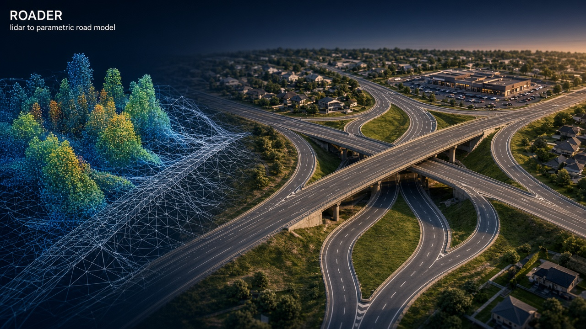

# Roader



Roader implements the Roadway Infrastructure Model (RIM): public airborne lidar
(USGS 3DEP) plus 2D road vectors in, a parametric road model out, and closed solid
meshes generated deterministically from that model. Scope is US limited-access
highways, ramps, interchanges and their grade separations.

The build specification is [ROADWAY_MODEL_SPEC.md](ROADWAY_MODEL_SPEC.md). Open
choices are logged in [DECISIONS.md](DECISIONS.md). Contributor and agent
conventions are in [AGENTS.md](AGENTS.md).

## Status

Milestone 1 (one rural freeway overpass, end to end) is done: every hard gate and
accuracy target passes on real lidar at Laurel Street over I-190, West Boylston MA,
against a reviewed reference. Milestone 2 (one full interchange)
is in progress. See [docs/RND_PILOT.md](docs/RND_PILOT.md).

## Quick start

```bash
python -m venv .venv
source .venv/bin/activate
pip install -e ".[dev]"
roader --help
```

## Setup

Roader ships no credentials or data. Each user supplies their own:

- **Python and PDAL.** Python 3.11 or later and `pip install -e ".[dev]"`.
  PDAL is installed separately (conda-forge or a system package).
- **Unit config.** One file per site in `configs/units/` (bbox, frame, inputs).
  Personal configs in `configs/*.toml` are not committed.
- **USGS 3DEP lidar and OSM extracts.** Public, no account needed:
  `python scripts/fetch_fixtures.py` fetches and pins the sites in
  `tests/sites.yaml` into `data/fixtures/`.
- **Build a unit.** `roader build --unit configs/units/<site>.toml --out DIR`
  runs lidar and vectors through to gated exports in `DIR/published/<site>/`
  (or `DIR/held/` if a hard gate fails). `tools/viewer/index.html` shows the
  meshes with an optional lidar overlay (`points_sample.glb`).
- **NAIP imagery (optional).** Requester-pays S3. You need your own AWS
  credentials (`aws configure` or the standard `AWS_*` environment variables)
  and you pay the transfer costs: `python scripts/fetch_naip.py`.
- **OpenStreetMap.** Fetched via osmnx, no key needed. Follow the ODbL
  attribution terms in [docs/THIRD_PARTY.md](docs/THIRD_PARTY.md).
- **val3dity (validation only).** Run `scripts/install_val3dity.sh`, then set
  `VAL3DITY` to the binary or put it on `PATH`. Without it the tests that need
  it are skipped and the AC-H1 gate fails.

Data and outputs under `data/` and `cache/` are not committed.

## Layout

| Package | Spec area |
|---|---|
| `roader.io` | Point, vector and inventory readers; reference frames (stages 1, 2) |
| `roader.evidence` | Road-surface labelling, layer separation, barriers (stage 3) |
| `roader.conflate` | Vector merge, registration, structure extents, crossings (stages 4, 5) |
| `roader.fit` | Alignment, profile, cross-section (stages 6, 7) |
| `roader.complete` | Occlusion completion, ground under bridges (stage 8) |
| `roader.structures` | Structure inference (stage 9) |
| `roader.rules` | Design-convention rule library (section 8) |
| `roader.model` | The section 5 schema, serialization, provenance |
| `roader.solids` | Sweeps, junction partition, terrain conformance (stage 10) |
| `roader.assets` | LOD, UVs, materials, instancing, collision (stage 11) |
| `roader.validate` | Solid checks, accuracy metrics, reports (stage 12) |
| `roader.export` | glTF, USD, OpenDRIVE, CityJSON, native model (stage 12) |
| `roader.build` | `roader build`: one unit config to a published unit |

## Docs

| Doc | Contents |
|---|---|
| [ROADWAY_MODEL_SPEC.md](ROADWAY_MODEL_SPEC.md) | Requirements, acceptance criteria, milestones |
| [DECISIONS.md](DECISIONS.md) | Decisions on open points |
| [docs/MODEL.md](docs/MODEL.md) | How the section 5 model is implemented |
| [docs/RND_PILOT.md](docs/RND_PILOT.md) | Milestone status and test sites |
| [docs/THIRD_PARTY.md](docs/THIRD_PARTY.md) | Libraries and data licenses |

## License

Apache-2.0 for Roader code (see [LICENSE](LICENSE)). Third-party and data terms
are listed separately.
